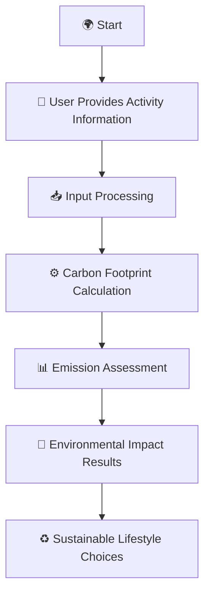
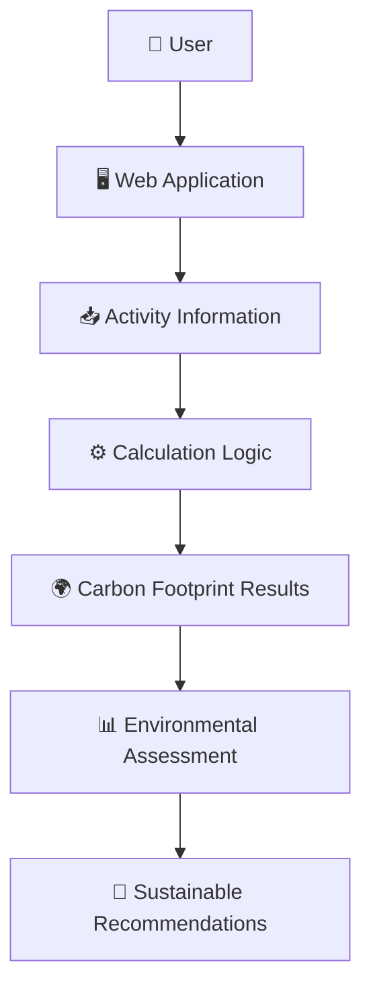

# 🌍 Carbon Footprint Tracker
### Understand Your Impact. Reduce Your Carbon Footprint. Build a Greener Future.

<p align="center">
  <strong>🌱 Measure • 📊 Understand • 🌍 Reduce • ♻️ Sustain</strong>
</p>

<p align="center">
  
  
  
  
</p>

<p align="center">
  <a href="https://github.com/YashwanthL18/Carbonfoot-print">📂 Repository</a> •
  <a href="https://github.com/YashwanthL18/Carbonfoot-print/issues">🐛 Report Issues</a> •
  <a href="https://github.com/YashwanthL18/Carbonfoot-print/forks">🍴 Fork Project</a>
</p>

---

## 📖 About The Project

**Carbon Footprint Tracker** is a web-based application designed to help individuals understand their environmental impact through carbon footprint estimation.

Everyday activities such as transportation, electricity consumption, food choices, and shopping can contribute to greenhouse gas emissions.

This project aims to make environmental awareness easier by helping users estimate their carbon footprint and understand opportunities to reduce their environmental impact.

### 🎯 Project Objectives

- 🌍 Raise awareness about climate change and carbon emissions.
- 📊 Help users understand their environmental footprint.
- 🌱 Encourage sustainable lifestyle choices.
- ♻️ Promote environmentally responsible habits.
- 💡 Help users identify opportunities to reduce emissions.

---

## ✨ Key Features

| Feature | Description |
|---|---|
| 🌍 Carbon Footprint Estimation | Estimate environmental impact using activity-related information. |
| 📊 Environmental Awareness | Help users understand their carbon emissions. |
| 🌱 Sustainable Living | Encourage environmentally friendly lifestyle choices. |
| ♻️ Emission Reduction | Promote actions that can help reduce carbon emissions. |
| 💡 Environmental Insights | Help users understand the importance of reducing their footprint. |

*Note: The features above describe the project's intended functionality. Exact implemented modules should be confirmed against the application source code.*

---

## 🌎 Understanding Carbon Footprint

A carbon footprint represents the total greenhouse gas emissions associated with an individual, activity, product, or organization.

It is commonly expressed in:

**kg CO₂e — Kilograms of Carbon Dioxide Equivalent**

CO₂e provides a common measurement for comparing the warming impact of different greenhouse gases.

### 🌿 Common Sources of Carbon Emissions

| Category | Examples |
|---|---|
| 🚗 Transportation | Cars, motorcycles, flights, public transport |
| ⚡ Electricity | Household electricity consumption |
| 🍽️ Food | Food production and consumption |
| 🛍️ Shopping | Clothing, electronics, and other purchases |
| 🏠 Household | Daily household activities and energy usage |

---

## 🔄 How It Works

The general carbon footprint assessment workflow:



---

## 🏗️ Project Architecture

The application is organized around a web-based carbon footprint assessment workflow.



---

## 💻 Technology Stack

The exact framework and libraries should be documented according to the dependencies and source files inside `CarbonCalculator/`.

| Component | Purpose |
|---|---|
| 🖥️ Frontend | User interaction and application interface |
| ⚙️ Backend | Application processing |
| 🧮 Calculation Engine | Carbon footprint estimation |
| 📊 Results | Presentation of environmental impact |
| 🗄️ Data Management | Handling application information |

---

## 📁 Project Structure

```text
Carbonfoot-print/
│
├── CarbonCalculator/
│   └── Application source files
│
├── .gitignore
│
├── LICENSE
│
└── README.md
```

The `CarbonCalculator/` directory contains the main application. Its internal files and subdirectories should be documented after inspecting the source code.

---

## 🚀 Getting Started

### 1. Prerequisites

Install Git and Python if your application uses Python:

```bash
sudo apt update

sudo apt install git python3 python3-pip python3-venv -y
```

### 2. Clone the Repository

```bash
git clone https://github.com/YashwanthL18/Carbonfoot-print.git
```

### 3. Navigate to the Project

```bash
cd Carbonfoot-print
```

### 4. Explore the Application Files

```bash
cd CarbonCalculator

find . -maxdepth 4 -type f | sort
```

### 5. Install Dependencies and Run

Follow the installation instructions for the framework and dependency files actually included in `CarbonCalculator/`.

For example, if it contains a Python `requirements.txt`:

```bash
python3 -m venv .venv

source .venv/bin/activate

pip install -r requirements.txt
```

Use the actual application entry point to launch the project.

---

## 📸 Application Screenshots

Screenshots can help users understand the application before downloading it.

Recommended screenshots:

| Screenshot | Description |
|---|---|
| 🏠 Home Page | Main application interface |
| 📝 Input Interface | Carbon footprint assessment inputs |
| 📊 Results Dashboard | Estimated carbon footprint |
| 🌱 Recommendations | Environmental awareness and reduction guidance |

To add screenshots, create an `assets` folder and add your actual application screenshots.

Example:

```markdown

```

---

## 🌱 Why Carbon Footprint Awareness Matters

Understanding our carbon footprint is an important step towards environmental responsibility.

Small changes in everyday life can contribute to a more sustainable future:

- 🚲 Choose cycling or walking for shorter journeys.
- 🚌 Prefer public transportation when possible.
- 💡 Reduce unnecessary electricity consumption.
- 🌿 Make environmentally conscious food choices.
- ♻️ Reuse and recycle materials.
- 🛍️ Avoid unnecessary purchases.

---

## 🔒 Privacy & Responsible Usage

- Avoid sharing unnecessary personal information.
- Do not commit passwords or API credentials.
- Keep application dependencies updated.
- Treat calculated emissions as estimates based on the methodology and emission factors used by the application.

---

## 🤝 Contributing

Contributions are welcome!

If you want to improve this project:

**1. Fork the repository**

**2. Clone your fork**

```bash
git clone https://github.com/YOUR_USERNAME/Carbonfoot-print.git
```

**3. Create a feature branch**

```bash
git checkout -b feature/new-improvement
```

**4. Commit your changes**

```bash
git add .

git commit -m "Improve carbon footprint tracker"
```

**5. Push your changes**

```bash
git push origin feature/new-improvement
```

**6. Open a Pull Request**

---

## 📜 License

This project is distributed under the **MIT License**.

See the [LICENSE](LICENSE) file for details.

---

## 📬 Developer & Repository

**Developer:** Yashwanth L

**GitHub Profile:** [@YashwanthL18](https://github.com/YashwanthL18)

**Project Repository:** [Carbonfoot-print](https://github.com/YashwanthL18/Carbonfoot-print)

---

## ⭐ Support This Project

If you find this project useful:

- ⭐ Star the repository.
- 🍴 Fork the project.
- 💡 Suggest improvements.
- 🐛 Report bugs.
- 🤝 Contribute to sustainability-focused development.

<p align="center">
  <strong>🌍 CARBON FOOTPRINT TRACKER</strong>
  <br/>
  <em>Think Green. Live Green. Keep Our Planet Clean. 🌱</em>
</p>
